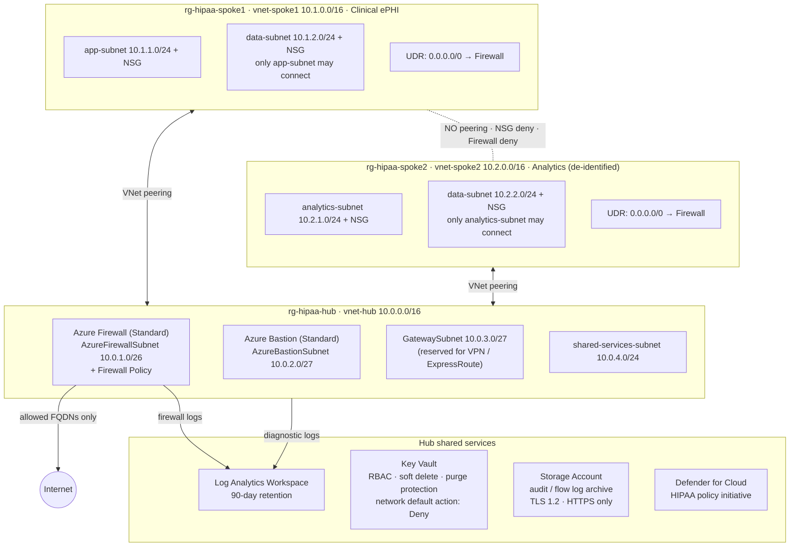
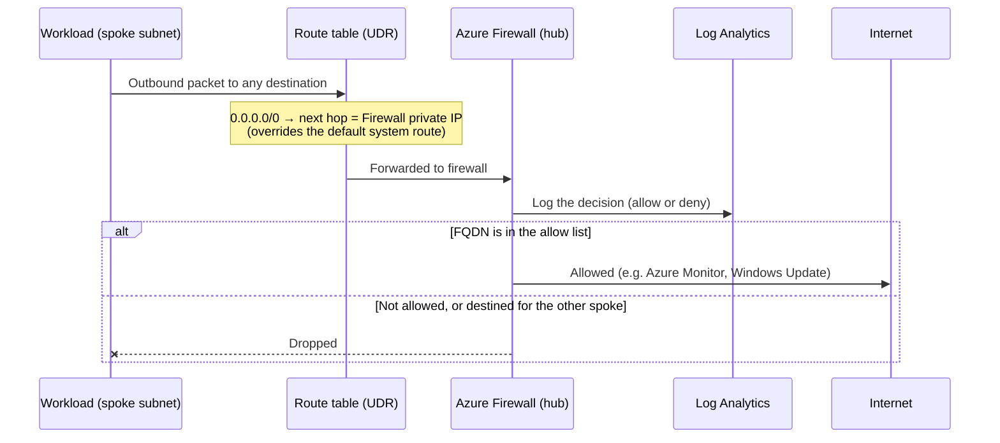

# HIPAA-Aligned Hub-and-Spoke Network on Azure (Terraform)

**Azure Firewall · VNet Peering · NSGs · UDRs · Bastion · Key Vault · Log Analytics · Defender for Cloud · Terraform**

> 🎥 **Video walkthrough (~5 min):** *loom link coming soon*

Infrastructure-as-code build of a hub-and-spoke network for a healthcare workload. A hub VNet owns the shared security services (firewall, Bastion, logging, secrets). Two isolated spokes hold the workloads: one for clinical systems that touch raw ePHI, one for analytics on de-identified data. Everything is deployed with Terraform and is repeatable with `terraform apply` / `terraform destroy`.

| | |
|---|---|
| **Build time** | 4–5 hours first time, ~20 minutes to redeploy |
| **Cost while running** | $8–15/day. Azure Firewall (~$1.25/hr) is the main driver, so destroy it when you're not using it |
| **Terraform** | v1.5+ with `azurerm ~> 4.0` |
| **Difficulty** | Intermediate–Advanced |

---

## Table of Contents

1. [The business problem](#the-business-problem)
2. [Architecture](#architecture)
3. [HIPAA §164.312 control mapping](#hipaa-164312-control-mapping)
4. [What gets deployed](#what-gets-deployed)
5. [Prerequisites](#prerequisites)
6. [Deploy](#deploy)
7. [Validate](#validate)
8. [Troubleshooting and lessons learned](#troubleshooting-and-lessons-learned)
9. [Teardown](#teardown)
10. [Design decisions](#design-decisions-and-why)
11. [What I'd add for production](#what-id-add-for-production)

---

## The business problem

Healthcare organisations that handle electronic Protected Health Information (ePHI) must implement HIPAA technical safeguards: access control, audit logging, integrity protection, and transmission security. Fines run up to $1.9M per violation category per year, and a breach means public disclosure.

Bolting these controls onto every application doesn't scale. The hub-and-spoke pattern puts them in one place:

- **One firewall policy** governs all egress and cross-spoke traffic.
- **One Log Analytics workspace** collects every audit log.
- **A new spoke inherits all of it**, so a new clinical app gets compliant network controls on day one.

**Where this applies:** a hospital separating EHR/imaging from reporting, an insurer isolating claims processing from fraud analytics, a pharma company separating trial data from BI, or a healthcare SaaS giving each tenant its own spoke.

> **Scope note:** This lab implements the *technical network controls*. A real HIPAA environment also needs BAAs, policies, physical safeguards, and organisational controls, which are out of scope here.

---

## Architecture

### Network topology



Spoke 1 and Spoke 2 are each peered to the hub, **never to each other**. The only path between them runs through the firewall, where it is inspected, denied, and logged.

### Traffic path: why the UDR matters



Peering alone does **not** force traffic through the firewall. Without the UDR, spoke traffic follows the default system route straight to its destination and skips inspection entirely.

---

## HIPAA §164.312 control mapping

This table lists what is **actually deployed** by the Terraform in this repo. Items that belong in production but are not built here are listed under [What I'd add for production](#what-id-add-for-production).

| HIPAA requirement | Control deployed | Terraform resource(s) |
|---|---|---|
| **Access Control** §164.312(a)(1) | Azure RBAC on Key Vault (no access policies). Bastion for admin access, so no public IPs or shared credentials on spoke resources | `azurerm_key_vault` (`enable_rbac_authorization`), `azurerm_role_assignment`, `azurerm_bastion_host` |
| **Audit Controls** §164.312(b) | Central Log Analytics workspace (90-day retention), firewall diagnostic logs, VNet flow logs with traffic analytics, audit storage account | `azurerm_log_analytics_workspace`, `azurerm_monitor_diagnostic_setting`, `azurerm_storage_account`, `azurerm_network_watcher_flow_log` (VNet flow logs scoped to all four spoke subnets) |
| **Integrity** §164.312(c)(1) | Soft delete on Key Vault and on audit blobs (90 days), purge protection on Key Vault (production setting) | `azurerm_key_vault`, `azurerm_storage_account` (`delete_retention_policy`) |
| **Transmission Security** §164.312(e)(1) | TLS 1.2 minimum and HTTPS-only on storage; Key Vault network ACL default `Deny`; firewall egress restricted to an FQDN allow list | `azurerm_storage_account`, `azurerm_key_vault` (`network_acls`), `azurerm_firewall_policy_rule_collection_group` |
| **Network Segmentation** (addressable) | Hub-and-spoke topology, NSGs on every spoke subnet, no spoke-to-spoke peering, cross-spoke traffic denied at **two** layers (NSG + Firewall) | `azurerm_network_security_group`, `azurerm_virtual_network_peering`, firewall network rules |
| **Threat Detection** (addressable) | Defender for Cloud (Servers, Storage, Key Vault plans) and the HIPAA built-in policy initiative assigned at subscription scope | `azurerm_security_center_subscription_pricing`, `azurerm_subscription_policy_assignment` |

---

## What gets deployed

```
Three resource groups
├── rg-hipaa-hub-<yourname>            Shared services
│   ├── vnet-hub                   10.0.0.0/16
│   │   ├── AzureFirewallSubnet    10.0.1.0/26
│   │   ├── AzureBastionSubnet     10.0.2.0/27
│   │   ├── GatewaySubnet          10.0.3.0/27
│   │   └── shared-services-subnet 10.0.4.0/24
│   ├── Azure Firewall (Standard) + Firewall Policy + public IP
│   ├── Azure Bastion (Standard) + public IP
│   ├── Key Vault
│   ├── Log Analytics Workspace (90-day retention)
│   ├── Storage Account (audit + flow log archive)
│   └── Defender for Cloud plans + HIPAA policy initiative
│
├── rg-hipaa-spoke1-<yourname>         Clinical ePHI
│   ├── vnet-spoke1                10.1.0.0/16
│   │   ├── app-subnet             10.1.1.0/24 + NSG
│   │   └── data-subnet            10.1.2.0/24 + NSG
│   ├── Peering ↔ hub
│   └── Route table: 0.0.0.0/0 → Firewall private IP
│
└── rg-hipaa-spoke2-<yourname>         Analytics (de-identified)
    ├── vnet-spoke2                10.2.0.0/16
    │   ├── analytics-subnet       10.2.1.0/24 + NSG
    │   └── data-subnet            10.2.2.0/24 + NSG
    ├── Peering ↔ hub
    └── Route table: 0.0.0.0/0 → Firewall private IP
```

**Repo layout**

```
hipaa-hub-spoke/
├── main.tf            # all resources
├── variables.tf       # address spaces, region, tags
├── outputs.tf         # IDs, firewall IPs, resource group names
├── terraform.tfvars   # your name suffix (git-ignored)
└── README.md
```

---

## Prerequisites

| Requirement | Verify with |
|---|---|
| Azure CLI, authenticated | `az account show` |
| Terraform v1.5+ | `terraform -version` |
| Azure subscription | `az account list --output table` |
| Owner, or Contributor + User Access Administrator | `az role assignment list --assignee $(az account show --query user.name -o tsv)` |

> ⚠️ **Use a personal or dev subscription.** This deploy turns on Defender for Cloud plans and assigns a policy initiative at *subscription* scope, which affects everything in that subscription.

---

## Deploy

### 1. Configure

```bash
cd ~/repos/hipaa-hub-spoke
echo 'yourname = "<yourname>"' > terraform.tfvars
echo 'location = "eastus2"' >> terraform.tfvars
```

Replace `<yourname>` with your own suffix (for example your initials plus a number). It is used in globally unique names (Key Vault, storage account), so keep it lowercase, alphanumeric, and short (storage account names max out at 24 characters).

> **Use the same value everywhere.** Every command below uses `<yourname>` as a placeholder. Substitute your suffix wherever it appears, so `rg-hipaa-hub-<yourname>` becomes something like `rg-hipaa-hub-jsmith1`.

### 2. Initialise and validate

```bash
az login
az account set --subscription "<subscription-id>"

# azurerm 4.x requires the subscription ID to be set explicitly
export ARM_SUBSCRIPTION_ID=$(az account show --query id -o tsv)

# Network Watcher: Azure allows one per region per subscription.
# If this lists NetworkWatcher_eastus2, see the Troubleshooting table before applying.
az network watcher list -o table

terraform init
terraform fmt
terraform validate
```

### 3. Plan and apply

```bash
terraform plan -out=hipaa.tfplan
terraform apply hipaa.tfplan
```

Azure Firewall takes 8–12 minutes to provision, so expect ~15–20 minutes total. If the apply fails partway, run it again and Terraform resumes where it stopped.

> **Flow logs:** Azure no longer allows creating new **NSG** flow logs (blocked since June 30, 2025; retirement is September 30, 2027). This lab uses **VNet flow logs** instead. They are the same `azurerm_network_watcher_flow_log` resource, but pointed at each spoke subnet with `target_resource_id`. They deploy as part of the normal apply.

---

## Validate

These checks confirm the key security properties without deploying any VMs. Replace `<yourname>` with the suffix you set in `terraform.tfvars`.

**1. Firewall is running and the policy is attached**

```bash
az network firewall show -n fw-hipaa-<yourname> -g rg-hipaa-hub-<yourname> \
  --query "{State:provisioningState, Policy:firewallPolicy.id}" -o table
```

**2. UDRs point at the firewall**

```bash
terraform output firewall_private_ip

az network route-table show -n rt-spoke1-<yourname> -g rg-hipaa-spoke1-<yourname> \
  --query "routes[].{Name:name, Prefix:addressPrefix, NextHop:nextHopIpAddress}" -o table
# Expected: 0.0.0.0/0 → <firewall private IP>
```

**3. Both peerings are Connected**

```bash
az network vnet peering list -g rg-hipaa-hub-<yourname> --vnet-name vnet-hub-<yourname> \
  --query "[].{Name:name, State:peeringState}" -o table
```

**4. NSGs deny internet and cross-spoke inbound**

```bash
az network nsg show -n nsg-spoke1-app-<yourname> -g rg-hipaa-spoke1-<yourname> \
  --query "securityRules[].{Name:name, Priority:priority, Access:access, Source:sourceAddressPrefix}" -o table
# Expected: deny-spoke2-inbound (3000, Deny) and deny-internet-inbound (4000, Deny)
```

**5. Key Vault network default action is Deny**

```bash
az keyvault show -n kv-hipaa-<yourname> --query "properties.networkAcls.defaultAction" -o tsv
# Expected: Deny
```

**6. Firewall logs reach Log Analytics** (run in the workspace's *Logs* blade)

```kusto
AzureDiagnostics
| where ResourceType == "AZUREFIREWALLS"
| where TimeGenerated > ago(1h)
| project TimeGenerated, msg_s, Protocol_s, SourceIP_s, DestinationIP_s, Action_s
| order by TimeGenerated desc
| take 50
```

> This returns rows only once something generates traffic. With no VMs in the spokes the table can be empty, which is expected.

**7. Flow logs exist on all four spoke subnets**

```bash
az network watcher flow-log list --location eastus2 \
  --query "[].{Name:name, Target:targetResourceId, Enabled:enabled}" -o table
# Expected: flowlog-spoke1-app, flowlog-spoke1-data, flowlog-spoke2-app, flowlog-spoke2-data
```

---

## Troubleshooting and lessons learned

Problems I hit (or caught in review) while building this, and how I fixed them:

| Issue | Cause | Resolution |
|---|---|---|
| **Firewall rules never applied** | The Firewall Policy was created but never attached to the firewall, so its rules were dead and everything was default-denied | Add `firewall_policy_id = azurerm_firewall_policy.hub.id` to `azurerm_firewall` |
| **NSG flow log creation fails** | Microsoft blocked creation of new NSG flow logs after June 30, 2025 | Use **VNet flow logs**: `azurerm_network_watcher_flow_log` with `target_resource_id` set to the subnet (azurerm 4.x) |
| **`subscription_id is a required provider property`** | azurerm 4.x no longer infers the subscription | `export ARM_SUBSCRIPTION_ID=$(az account show --query id -o tsv)` |
| **`NetworkWatcher` already exists** | Azure allows one Network Watcher per region per subscription and usually auto-creates `NetworkWatcher_<region>` in `NetworkWatcherRG` | Reference the existing one with a `data "azurerm_network_watcher"` block instead of creating a new resource |
| **Key Vault name is reserved after destroy** | Purge protection keeps the vault in soft-delete for the full retention period, so `az keyvault purge` is refused | The provider's `recover_soft_deleted_key_vaults = true` recovers it on the next apply. Use a different `yourname` for a clean slate. Keep purge protection on in production |
| `AzureFirewallSubnet` creation fails | Name must be exact and the prefix `/26` or larger | Fix the subnet name or prefix |
| Peering fails with `RemoteVnetNotFound` | Spoke VNet not finished yet | Add `depends_on` for the spoke VNet |
| Policy assignment fails, insufficient privileges | Missing Owner / Resource Policy Contributor | Grant the role at subscription scope |
| Spoke workloads can't reach the internet | UDR is in place but the firewall allow list lacks the FQDN | Add the FQDN to the `allow-azure-services` rule collection |
| `apply` times out on the firewall | Firewall provisioning can exceed 12 minutes | Re-run `terraform apply` |

---

## Teardown

```bash
terraform destroy
```

Azure Firewall bills hourly, so destroy promptly when you're done.

---

## Design decisions and why

- **Hub-and-spoke over per-workload security.** Controls are centralised and new spokes inherit them.
- **UDR + Firewall, not peering alone.** Peering gives connectivity, not inspection. The `0.0.0.0/0` route is what forces traffic through the firewall.
- **Two independent layers block spoke-to-spoke traffic.** The NSG deny rule and the Firewall network rule each stop it, so one misconfiguration doesn't cause a breach.
- **Separate resource groups per spoke.** RBAC and cost can be scoped per workload, and the clinical and analytics environments are isolated.
- **RBAC authorization on Key Vault.** Auditable through Entra ID and consistent with the rest of the access model.
- **Everything in Terraform.** Repeatable, reviewable, and cheap to tear down, which matters when the firewall costs ~$1.25/hr.

---

## What I'd add for production

These are controls HIPAA environments typically need that are **not** implemented in this lab:

- **Private endpoints** for Key Vault, Storage, and SQL (the Key Vault here uses network ACLs, not a private endpoint)
- **Customer-managed keys** in Key Vault for encryption at rest, plus **TDE** on any Azure SQL databases
- **Immutable (WORM) storage policy** on the audit log container
- **Azure Policy** to enforce TLS 1.2 and deny public endpoints on new resources
- **DDoS Protection Standard** on the hub VNet
- **VPN or ExpressRoute gateway** into the reserved `GatewaySubnet` for on-premises connectivity
- **365+ day log retention** (90 days is the lab minimum)
- **Sample workloads** in the spokes so firewall and flow log data can be demonstrated end to end
- **Remote state** in a storage account with locking, and a CI pipeline running `terraform fmt`, `validate`, and `plan` on pull requests

---

## Skills demonstrated

Azure networking (hub-and-spoke, peering, UDRs, NSGs, Azure Firewall policy) · Infrastructure as Code (Terraform) · Security and compliance mapping (HIPAA §164.312) · Centralised logging and monitoring (Log Analytics, flow logs, diagnostics) · Secrets management (Key Vault RBAC) · Cost-aware design and troubleshooting
